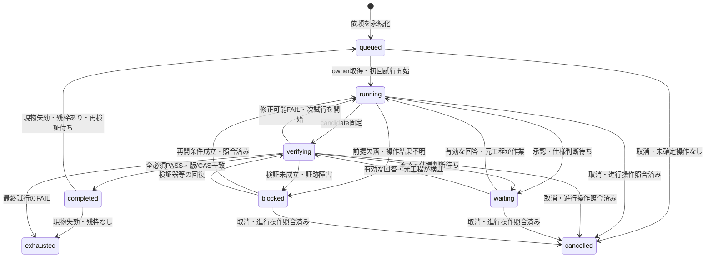
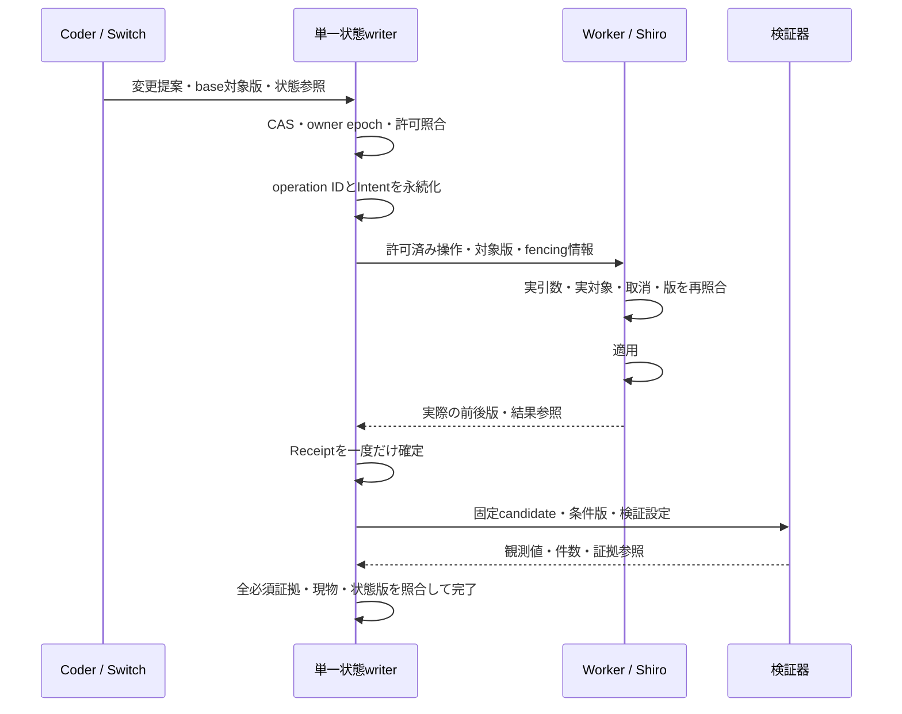

# RenCrow 共通ハーネス実装仕様 v1.0

## 0. 概要・適用条件

本書は、ユーザー提示の「RenCrow 共通ハーネス実装仕様 v1.0・2026-11-26・設計案」を、既存コードに割り当てた実装仕様である。全体設計には後続段階の論理型・動作も含む。実装済みの範囲と正本は§0.3に示し、それ以外を現行APIや受入済みの機能として扱わない。

目的は、依頼の途中報告、Compaction、再起動をまたいでも、対象版・条件版・権限・実行事実を保持し、検証済みの成果だけを完了にすること。初回の縦断対象は「指定不具合を修正し、指定された再現テストと回帰テストを通す」一件とする。

通常の依頼入口を使用する。雑談・説明には追加の実行ループやタスク履歴検索を起動しない。新規タスクで `common-harness/1.0` を選択した場合だけ本契約を適用し、既存タスクは開始時の契約を維持する。

### 0.1 照合範囲と参照資料

2026-11-26の作業ツリーを調査した。各repoは未コミット差分を含むため、HEADだけを「照合した版」と扱わない。

| repo | 調査開始時HEAD | 作業ツリー差分SHA-256（文書追加前の `git diff --binary HEAD`） |
|---|---|---|
| RenCrow_Switch_Core | `5ceed91532a4f65bae573ab90e8733ddffcd7f47` | `475e0eccfd66cb527cbd47976d86eda1661879048067603be2aeb691f1b6dff4` |
| RenCrow_CORE | `5ba3b4c920df738c7abb2365b6eb9cf69878e840` | `e5839207bfe75f2f298d1ecfdbe523c5bbfce706ea008a0566d73b0db444b8a1` |
| RenCrow_Harness | `2a1780225801054f6b4161efb8acf6f88fa0296d` | `da01b36ddc45e80c8ac55bccf8543312cfed768b878a867eb6fec6a17cb5f7dc` |
| RenCrow_LLM | `ac5e54cc83df47be1a746cb1e40e122b196da33e` | `c2690bbf2cb82bb1ef140d2206016884bcedd107ffeb339a970ea9b31afe4f10` |

主要な関連文書は [自律完了仕様](AUTONOMOUS_COMPLETION_SPEC.md)、[task context仕様](TASK_CONTEXT_COMPACTION_SPEC.md)、[実行契約](EXECUTION_GUARD.md)、[role tool policy](ROLE_TOOL_POLICY.md)、[既存Go Harness仕様](../RenCrow_Harness/docs/RenCrow_Harness_SPEC.md)、[CORE作業境界](../RenCrow_CORE/rules/task-rules.md) とする。

上表のdiff hashは未追跡ファイルを含まず、完全なbuild source manifestの代用ではない。今回の対応表はリンク先の現物との照合結果であり、実装着手時は関連する未追跡ファイルも含めてsource版を固定し直す。

ユーザー案が参照する `RenCrow_Char_README.md` は、今回のローカル限定検索で未発見。「現行の考え方」「重要な注意」の本文は未照合であり、読了した資料として扱わない。Mio/Coder/Shiroの境界はユーザー提示要件として採用し、現行COREとの一致・不足は本書で区別する。Shiro接続の実装着手時には当該参照の所在・現行性も確定する。

設計の定石として [Claude Cookbooks: Evaluator–Optimizer](https://github.com/anthropics/claude-cookbooks/blob/main/patterns/agents/evaluator_optimizer.ipynb) の「評価対象・基準・結果・feedbackを分ける」構成を参照した。機械条件の判定、永続化、CAS、権限判定はhostが行い、LLM評価に委ねない。この資料から外部副作用のexactly-once保証を導かない。

### 0.2 用語と既存仕様との関係

- **共通ハーネス契約**は、本書のタスク実行・証拠・再開の振る舞いを指す。独立Go製品 `RenCrow_Harness` の別名ではない。
- 既存Switchの `CompletionState`、task boundary、検査台帳、rolloutを拡張する。並行する完了判定ループ、別DB、新しい監視サービスは作らない。
- 既存Go Harnessは独自Service/Kernel/SQLiteと子Taskの所有権を持つ。そのままShiro唯一適用の契約を満たすとは扱わず、独立した第二のroot状態writerとして接続しない。
- v1タスクでは、機械必須条件の未達を意味判断やwaiverでPASSへ変換しない。条件の削除・弱化・権限拡大は、権限ある利用者の変更指示に基づく新しい依頼版として記録する。legacyの契約は変更しない。

### 0.3 Switch S1の先行実装（2026-11-27）

WP01〜05の最初の導入単位は、Switch単体で明示した通常ファイル集合を修正し、登録したGo検査で判定するタスクとする。`task_context_boundary` の `Begin.common_harness_request` で明示的に契約を選び、条件一覧のない既存タスクは従来経路を使う。

| 実装範囲 | 現在の正本・確認する振る舞い |
|---|---|
| 依頼・状態・有限試行 | [common_harness.rs](codex-rs/history/src/task_context/common_harness.rs)。依頼・条件・対象・状態の版、単一writer、初回を含む有限試行、待機・停止理由を既存snapshotへ保存 |
| 実行事実と機械判定 | [exec_command.rs](codex-rs/core/src/tools/handlers/unified_exec/exec_command.rs)、[task_check_expected_negative.rs](codex-rs/core/src/task_check_expected_negative.rs)。実Go結果と登録条件を照合。期待負例の元FAILを残し、解決記録を別に保存 |
| 対象変更・完了 | [common_harness_completion.rs](codex-rs/core/src/session/common_harness_completion.rs)、[common_harness_iteration.rs](codex-rs/core/src/session/common_harness_iteration.rs)。古い合格を失効し、予約した次unitを実Beginで再開。現在版の全必須証拠とcheckpointを確認してhost結果を返す |
| 適用・障害復旧 | [apply_patch.rs](codex-rs/core/src/tools/runtimes/apply_patch.rs)、[common_harness_native_patch_recovery.rs](codex-rs/core/src/session/common_harness_native_patch_recovery.rs)。Intent・実行claim・成功完了marker・journal・owner引継ぎを照合。元Receiptが不明ならUnknownを保存し、根拠ある確定を別記録にする。patchを自動再適用しない |
| 圧縮・再開 | [common_harness_prompt.rs](codex-rs/core/src/session/common_harness_prompt.rs)。現在の正本から目的・制約・条件・版・次操作を入力へ再構成。既存方式による8,000推定tokenの枠を超えた場合は省略せずblocked。実圧縮と別プロセスでのcold再開を検査 |
| 道具・推論記録 | 工程・担当・task権限を提示時と実行時に照合。reviewerは対象限定読取りのみ。既存モデル経路の要求値・送信値・未対応値・確認できたbackend identityを記録し、未観測の物理適用は断定しない |

共通契約の開始には既存rollout traceの実保存先が必要である。通常起動では `CODEX_ROLLOUT_TRACE_ROOT` を設定する。テストでは構築時に保存先を注入し、プロセス全体の環境変数や作成済みSessionの自己参照を変更しない。

最終の自動検査は、`just clippy -p codex-core -p codex-history -p codex-rollout-trace -j 1 -- -D warnings`（エラー0・警告0）、機能固有172件（全件成功）、既存Switch基本セット45件（全件成功）である。Nextestの実カタログから対象を固定し、ignored・0件を成功に含めない。障害注入用の子プロセス入口3件は受入件数から除き、親の受入ケースから起動する。

この結果は、下表の全段階・全variantの一括受入ではない。Shiro接続、意味レビューの生成経路、工程別推論設定の拡張、一般の外部副作用、利用者UIからの承認・取消・条件変更の接続は後続範囲であり、型・reducerの試験を実接続の証拠にしない。一般のテスト改変耐性や任意のGo依存範囲まで保証するものではない。通常依頼入口の実モデル縦断、ビルド成果物、Push、ren2の稼働反映は、それぞれ別の実行証跡で確認する。

## 1. 責務と実行主体

| 論理責務 | Switch先行実装 | RenCrow接続時 |
|---|---|---|
| 受付・返却 | 通常入力から作業依頼を構造化し、既存task boundaryへ登録 | Mioが既存Task IDと依頼版を渡し、結果・progressを返却 |
| 思考・制御 | 既存モデル呼出しへ工程別の要求設定を渡す | Coderへplan/patch/proposalの生成を依頼 |
| 記憶・文脈 | host task contextから短い作業状態を再構成 | 同じ正本の参照を受け取り、必要資料だけ取得 |
| 手順 | Skill参照のID・版・digestを固定 | 同じ参照をShiro/Coderへ渡す。Skill自体は権限を付与しない |
| 道具・分業 | registryとrole/task/phase policyを交差。モデルのtool callは実行提案 | Coderの提案をShiroの既存Worker実行経路へ渡す |
| 操作の適用 | Switchの既存host executorがWorker役として許可・適用・記録 | **Shiroだけ**が副作用を適用。Switchローカル実行へのfallbackは禁止 |
| 状態遷移・完了 | Sessionのhost ownerが単一writer | Shiro側CoordinatorがCORE TaskStoreに書く。Switch/Mio/BOARDは参照・提案・projection |

状態writerと副作用適用者は責務を分けるが、v1タスクごとにそれぞれ一意のownerを固定する。単体ではSwitch内、RenCrow経由ではShiro側に置く。同じタスクで両方の適用経路を同時に有効にしない。子は子の実行結果を返し、親の正本を直接更新しない。

Coderの `apply_patch` 呼出しも「提案されたパッチ」であり、適用許可ではない。host dispatcherが版と権限を確認してからWorkerへ渡す。MCPやextension経由の書込みも同じ境界を通し、別経路へ逃がさない。

## 2. 既存コードへの割当と不足

| 要求 | 確認した現行の入口・型・保存先 | 再利用・追加する契約 |
|---|---|---|
| 通常ターン | [session/turn.rs](codex-rs/core/src/session/turn.rs) `run_turn` | 新規の作業依頼登録後だけ共通状態を評価。通常応答とタスク完了を分離 |
| 依頼・条件・小課題 | [task_context.rs](codex-rs/history/src/task_context.rs) `StoredTaskState`, `CompletionState`, `AcceptanceCondition`, `CompletionUnit` | 既存ID・条件revisionを使い、契約タグ、固定依頼、有限試行、CAS状態を追加 |
| 登録・更新・採用 | [task_context_boundary.rs](codex-rs/core/src/tools/handlers/task_context_boundary.rs) `Begin/Update/Status/Accept/Review/AdoptReview` | 入口を再利用。v1ではhost状態全体のLLMによる再構築を要求せず、版付きの小さい変更提案を受ける |
| 検査証跡 | [task_check.rs](codex-rs/core/src/task_check.rs) `TaskCheckExecution`, `TaskCheckObligation`, `TaskCheckReceipt`, `TaskCheckLedger` | task/revision/cwd/command/artifactの束縛を再利用。条件別観測値、対象テスト数、検証器版との結合を追加 |
| 保存・復元 | [completion_persistence.rs](codex-rs/core/src/session/completion_persistence.rs) `persist_autonomous_completion_snapshot`、host metadata付きrollout | host由来の証拠・状態を拡張保存。モデル作成JSONからは復元しない |
| 完了・証拠失効 | [session.rs](codex-rs/core/src/session/session.rs) `autonomous_completion_is_complete` と [completion_recovery.rs](codex-rs/core/src/session/completion_recovery.rs) | 現物との照合・未回収作業の拒否を再利用し、v1の全必須条件・版・未確定操作を追加確認 |
| レビュー | [completion_children.rs](codex-rs/core/src/session/completion_children.rs)、[multi_agents/spawn.rs](codex-rs/core/src/tools/handlers/multi_agents/spawn.rs) | 既存の正規起動・世代束縛・回収・採用を再利用。型付きReviewPacketと条件別判定を追加 |
| tool権限 | [rencrow_tool_allowlist.rs](codex-rs/core/src/tools/rencrow_tool_allowlist.rs)、[実行guard](codex-rs/core/src/rencrow_execution_guard.rs) | 既存制限を維持し、工程・タスク・実引数対象の交差判定を実行直前にも適用 |
| 実行器 | [apply_patch.rs](codex-rs/core/src/tools/handlers/apply_patch.rs)、[unified_exec](codex-rs/core/src/tools/handlers/unified_exec.rs) | 全副作用の直前に操作Intent、認可、fencingを結合。既存の検査記録だけを一般操作の耐障害保証とみなさない |
| 排他 | [thread-store/local/live_writer.rs](codex-rs/thread-store/src/local/live_writer.rs) のwriter lock | thread排他を再利用。タスク状態CAS・owner epoch・古い実行者の拒否は追加が必要 |
| CORE側owner | [task/store.go](../RenCrow_CORE/internal/domain/task/store.go)、[task_owner_durability.go](../RenCrow_CORE/internal/infrastructure/persistence/task/task_owner_durability.go) | `TaskTransaction`, `WithTaskExecutionFence`, `ExecuteIdempotentTaskOperation` を接続候補とする。CORE TaskStoreはJSONL/segmentでありSQLiteではない |
| COREの操作 | [execution/model.go](../RenCrow_CORE/internal/domain/execution/model.go) `Action`, `Record` | Task/Trace/Action/Attemptの既存IDを対応付け、共通の許可・Intent・証跡との結合を追加 |
| Go Harness | [writer.go](../RenCrow_Harness/internal/session/writer.go)、[001_initial.sql](../RenCrow_Harness/migrations/001_initial.sql)、[protocol/types.go](../RenCrow_Harness/pkg/protocol/types.go) | lock/epoch/unknown/receiptの実績を参照。独立Start経路をそのまま第二の状態正本にしない |

現行のmutexによる同一Sessionの保存直列化と、期待状態版CASは異なる。`contract_revision`、条件の`revision`、小課題の`task_revision`、ファイルSHAも、それぞれ別の版である。一般操作のdurable Intent、タスク全体の試行上限、Skill固定版、工程別設定の適用記録は不足として実装する。

## 3. データ契約

以下は追加予定の論理型。Switchでは `CompletionState` にhost所有のoptionalなv1拡張を置き、既存host snapshotへ保存する。新しいタスク台帳を並行運用しない。CORE接続時は同じ意味を既存TaskStoreのowner記録へ対応付ける。

Switchでは `CompletionState.common_harness: Option<CommonHarnessStateV1>` をS1で追加した。拡張は不変の依頼参照、TaskRunState、操作/証拠index参照を持ち、本文は既存rolloutのhost記録へ置く。条件ID・revision・小課題IDは既存型を使い、既存 `AcceptanceCondition` に不足する型付き判定メタデータを追加する。条件定義・証拠・statusを独立した二重正本にせず、同じhost reducerが整合するprojectionを生成する。この拡張はモデル入力の自由更新対象に含めない。

| レコード | 必須項目・制約 |
|---|---|
| TaskRequest | `contract_version`, `task_id`, `request_revision`, `authorized_request_ref`, `goal`, `workspace_ref`, `start_target_version`, `permission_snapshot_ref`, `constraints`, `conditions`, `condition_set_revision`, `max_attempts`, `operation_limits_ref`, `skill_refs`, `execution_owner`。受付完了後は不変。変更は新revision |
| ConditionSpec | `condition_id`, `condition_revision`, `kind`, `comparison_scope`, `expected`, `required`, `verifier_ref`, `verifier_config_revision`, `dependency_refs`。初回kindは再現前後と指定test suite。意味条件は項目を列挙 |
| TaskRunState | `task_id`, `request_revision`, `state_version`, `owner_id`, `owner_epoch`, `status`, `phase`, `attempt_no`, `target_version`, `unmet_conditions`, `next_operation`, `reason_code`, `resume_condition`, `cancel_requested`, `unsettled_operation_refs` |
| OperationIntent | `operation_id`, `task_id`, `request_revision`, `attempt_no`, `owner_epoch`, `expected_state_version`, `base_target_version`, `operation_kind`, `normalized_arguments_ref/digest`, `permission_decision_ref`, `approval_ref`, `executor_ref`, `timeout`, `intent_status`。実行前に永続化 |
| OperationReceipt | 同じoperation/task/owner、`execution_id`, `outcome`, `actual_before_version`, `actual_after_version`, `exit_status`, `result_ref`, `external_receipt_ref`, `reconciliation_ref`。同一操作の確定は一度だけ |
| ConditionEvidence | `condition_id`, `condition_revision`, `condition_set_revision`, `request_revision`, `target_version`, `comparison_scope_digest`, `execution_id`, `operation_id`, `verifier_ref/config_revision`, `observed`, `verdict`, `log_refs`, `artifact_refs`。再結合時は`source_evidence_ref`と照合根拠も持つ。hostが実行結果から生成 |
| SkillRef | 既存Skillの`id`, `version_ref`, `content_digest`, `source_ref`。版名がなければ実内容digestを版識別に含める。変更を無断で追従しない |
| ModelSettingsReceipt | `phase`, `model_route`, `model_identity`, `requested`, `effective`, `effective_source`, `unsupported_fields`, `fallback_reason`, `config_revision`, `call_ref`, `usage_ref` |

`request_revision`は目的・権限・対象・予算・条件参照を固定する版、`condition_revision`は個別判定規則の版、`state_version`はCAS用の単調増加版、`target_version`は現物内容の版とする。試行番号をこれらの代用にしない。既存の検査用 `task_revision` やtool再試行のAttempt IDとも区別する。

既存Task IDがある場合はそれをrootとして使う。なければ既存hostのID発行機構で一度だけ発行する。thread IDは保管容器、子task IDは実行単位であり、root Task IDと混同しない。モデルにID/hashを生成・計算させない。native call IDとCORE Action IDの形式が異なる場合は対応表を保存し、文字列連結で別型を偽造しない。

### 3.1 成果物版

受付時に、書込許可範囲とは別に**検証に関係する入力範囲**を固定する。対象ソース、指定テスト、依存manifest、検証設定などを含める。未コミット内容、untrackedの対象、新規作成予定パスの不存在、削除を区別する。Git HEAD、mtime、ファイル数だけでは版にならない。

Switch初回の対象は、canonical workspace配下の明示した通常ファイル集合とする。既存`hash_workspace_artifacts`の上限（16ファイル、各16 MiB）内の小さいfixtureで縦断する。これを超える対象は能力不足として受付時に明示し、対象を勝手に減らしたり、開始済みv1タスクをlegacyへ逃がしたりしない。symlink、特殊ファイル、読取不能、パスの衝突は初回では未対応として拒否する。

追加する`ArtifactSetV1`は次の順の構造体をJSON化し、既存`compaction_candidate::digest`のSHA-256実装を使う。entriesは正規化相対パスのUTF-8順とする。fileのSHAは生bytesに対するものとし、改行変換しない。

```text
ArtifactSetV1 = {
  format: "common-harness-artifact-set/1",
  workspace_binding_ref,
  scope_revision,
  git_commit_ref: optional,
  entries: [ {path, kind: file|absent, executable, sha256} ]
}
```

`absent`は`executable=null, sha256=null`。この表現・並び・Unicode・不存在・mode変更の固定vectorを実装と同時に追加する。ローカルの新しい版形式であり、既存HarnessのCJ1や公開digest形式へ黙って流用しない。RenCrow接続ではownerが発行した版とmanifest参照を渡し、別の実行者が独自方式で計算し直さない。公開wireへ追加する段階で既存byte契約・schema・vectorも更新する。

範囲外の入力が検証へ影響すると分かった場合は、依存範囲の不足として関連証跡を失効させる。権限内で範囲を修正できるなら新しいscope/依頼版を保存し、権限拡大や意味の変更が必要ならwaiting。影響を把握できなければblockedとする。

### 3.2 証拠の版の違い

- 適用記録は `Proposal.base_target_version → ApplyReceipt.actual_after_version` を証明する。
- 検査記録の `artifact_before == artifact_after` は、**検査中に対象が変化しなかった**証明であり、実装前後の比較ではない。
- 再現前の失敗証拠は固定baseline版、修正後の成功証拠は現在candidate版に結ぶ。条件がその二版の対応を要求するため、baselineの失敗を現在版の失敗へ混同しない。
- 依頼版・条件版・現在対象版との結合が不明な証拠はPASSにしない。無関係な条件まで一律に消さず、依存する条件だけを再検証対象にする。

全体の対象版・依頼版・条件集合版が変わっても、個別条件の定義、宣言した依存範囲のbytes、検証器/設定、許可根拠が不変とhostが確認できる場合は、元証拠を参照した**新しい再結合記録**を現在版へ作れる。元Receiptの実行版・日時・観測値は書き換えず、再実行したとも報告しない。確認できない依存は再検証する。この処理で既存の失敗義務、未確定操作、必要reviewを消してはならない。完了時には、この現在版への結合までを検査する。

## 4. 受付と通常入口

1. 通常の依頼処理で、MioまたはSwitchの親が作業目的・許可根拠・検証可能な条件を構造化する。新たな分類専用モデル呼出しは追加しない。
2. 雑談・説明は作業契約を登録しない。単語の一致だけで実行ループを開始しない。成果が変わる曖昧さが残る場合だけ確認する。
3. hostが既存task boundaryの登録入口で、依頼参照、対象、権限、条件、有限上限、実行owner、契約版を検証する。モデルの「workです」という自己申告だけで操作権限を作らない。
4. `max_attempts`は正の有限整数として受付時に確定する。初期試験値は3。条件・前提が不足している間は実行を開始しない。
5. TaskRequestとqueued状態の永続化成功後に、既存の継続判定へ接続する。別の常駐loopは作らない。

初回のbugfix条件は、少なくとも「指定再現ケースがbaselineで意図した理由により失敗し、candidateで成功」と「指定回帰スイートの必須ケースが実行され失敗0件」を分ける。既に修正済みなら偽の不具合やパッチを作らず、再現不能の観測を返し、必要な条件変更を別revisionとして扱う。

既存 `rencrow_autonomous_completion` は継続制御の入口として使うが、ONだけで旧タスクをv1へ変換しない。追加予定の新規受付ポリシーは既定legacyとし、v1有効化時も既存guard・sandbox・認証を維持する。新しい設定や型のschemaが実装されるまでは実運用設定へ投入しない。

## 5. 状態遷移と試行



| 状態 | 永続化する判断と次動作 |
|---|---|
| queued | 担当取得前。権限・前提が有効なら排他取得し、試行1を保存して開始 |
| running | plan/適用/照合を行う。既存成果を検証できる場合も、試行開始を記録した上でverifyingへ |
| verifying | 同じcandidate版で必須条件を評価。全PASSなら完了前ゲート。修正可能FAILなら次試行、枠なしならexhausted |
| waiting | 質問、操作、引数digest、対象版、戻る工程を保存。推論を止める。有効範囲の回答だけで再開 |
| blocked | 理由・未確定操作・再開条件を保存。heartbeatや経過時間だけで再開しない |
| exhausted | 未達条件・最終観測・消費試行を返す。新turnや子の作り直しで予算を回復しない |
| completed | 対象版・条件版に対する完了snapshotと条件別証拠を返す |
| cancelled | 新規操作が禁止され、既知の進行操作の照合が終わった状態。発生済み副作用の巻戻し完了を意味しない |

試行は最初のworkまたはverify開始前に永続化し、そのwork＋verifyを一回とする。正常に完走した検証の修正可能FAIL、または完了後の対象失効に基づく新しい再検証を開始する場合だけ、残枠を確認して次の試行へ進める。新試行には未達条件・観測値・変更する仮説/操作を結び付け、同条件の盲目再実行は行わない。

試行上限だけで、一試行内の無限調査を防げるとはみなさない。model/提案生成/review/実行/検証には、既存運用設定を参照した有限の親操作timeoutを固定する。配下の読取・モデル呼出しへ残り期限を引き継ぎ、progress・圧縮・再起動・別名の同種読取で期限を更新しない。期限到達は当該処理の結果を照合してblockedとし、同条件の自動再送を止める。承認待ちで未実行の操作は実行timeoutを開始せず、waiting復元だけでmodelを呼ばない。

途中報告、モデルターン、Compaction、再起動、同じ操作の照合・記録補完では試行を増減しない。条件変更も消費数を自動リセットしない。追加予算は権限ある明示変更として記録する。task試行上限は、既存のレビューexact-attempt制限、tool再試行上限、操作timeoutを上書きしない。

`running`中の適用失敗で状態が不明ならblocked。適用が確実に未実行で、原因が修正可能な提案不備なら同じ試行内で提案を訂正する。提案不備の訂正にも既存の上限を適用し、無限生成を許可しない。

### 5.1 判定と状態の対応

| 検証結果 | 意味 | 状態への反映 |
|---|---|---|
| PASS | 検証器が正常に完走し、対象・件数・観測値が条件に一致 | 条件証拠を採用 |
| FAIL | 検証器は成立したが条件未達。正常な収集で対象テスト0件も含む | 修正可能性・残枠によりrunning/exhausted |
| INDETERMINATE | 必須の比較資料・意味判断の根拠が不足 | 不足の解消方法によりblocked/waiting。PASSにはしない |
| ERROR | 検証器起動失敗、環境不備、ログ破損、収集器障害などで検証未成立 | blocked。同じ試行の回復経路へ |

対象プログラムのクラッシュが、正常に動いた検証器による不具合の観測ならFAILであり、検証器自身の障害と区別する。失敗再現のPASSには、選択ケースが実行され、期待した失敗理由が観測されることが必要。コンパイル不能やCLI不存在だけでは再現成功にしない。

## 6. 操作前後の制御と書き手排他

本書のHooksは**既存実行入口内の処理位置**を指す。外付け拒否スクリプトやプロンプト規則で置き換えない。



1. モデルに提示したtool集合と、実行時の認可を分ける。実行前にactor/phase/task/target/実引数/ユーザー許可/取消状態を照合し、allow・ask・denyを決める。既にある許可を再要求しない。
2. askでは操作に束縛したwaitingを保存する。denyは操作を実行せず理由を返す。認可不能はblocked。拒否や確認待ちを別tool・local executor・別資格情報へ自動転送しない。
3. 許可された操作IDとIntentをdurableに予約する。保存失敗なら実行しない。同じ操作ID＋同じ引数には同じ記録を返し、同じID＋違う引数は競合として拒否する。
4. Workerは実行直前にも対象を正規化し、base版、owner epoch、承認の束縛を確認する。パッチは許可パス・preimageと一致した場合だけ適用する。
5. 結果の実版、終了状態、ログ/外部受付IDを記録する。記録が未確定なら成功扱いせず、後続の副作用を止めて照合する。

状態遷移は `expected_state_version == current` と有効な `owner_epoch` を条件に一度だけ確定し、状態版を増やす。モデルにはhost状態全体のコピーを要求せず、既存task boundaryのv1分岐で小さい変更意図をhost reducerへ渡す。権限・証拠・counter・leaseはhost専有とし、LLMの自由記述で更新しない。CAS不一致時は副作用を実行せず最新参照を返す。

v1のstatus表示は制御に必要な現状態と証拠参照を標準とし、長い履歴・Receipt本文は条件/operation指定とcursorによる限定取得へ分ける。既存legacyのstatus形式は維持する。正本snapshotの既存サイズ制限を超える場合も、条件・ID・権限を黙ってtruncateしない。本文は既存参照先へ置き、必須の制御情報を保存できなければblockedとする。

既存thread writer lockを取得したownerだけがタスクのwriter世代を取得する。**thread lockは既存、Task writer epoch/fenceとの結合は新設**であり、別threadによる同じTaskの取得も同じTask単位の排他経路へ集約する。期限切れ担当の更新・新規実行は拒否するが、期限やheartbeatの古さだけで生きたOS lockを奪わない。引継ぎ時はlock解放と新epoch取得を必要とし、旧epochの遅延結果は新ownerが照合して取り込む。

承認は `task/request revision + operation ID + target version + arguments digest + capability scope` に束縛する。どれかが変わった操作へ流用しない。承認後の変更・取消との競合も、実行権取得のCASとWorker直前照合で処理する。

## 7. ツールとレビューの実効的な制限

提示集合は `登録済み ∩ 担当許可 ∩ 工程許可 ∩ タスク許可` とする。registryの正式名・入力schema・実行アダプタ・副作用種別を束縛し、実行時にも同じ集合と実対象を確認する。不明な副作用を「readらしい」と推定して許可しない。

v1のレビュー工程には、対象manifest内のファイル読取・範囲検索・比較だけを公開する。汎用 `exec_command`、そのshellを操作する`write_stdin`、書込可能MCP資格情報、外部送信、再委譲は渡さない。readonly sandboxだけを根拠に任意shellを許可しない。既存native filesystem読取層を再利用した限定アダプタを追加し、shell文字列へ戻して実装しない。対象外パス、symlinkでの脱出、TOCTOU、サイズ/範囲上限を実行側で検査する。

この制限は契約を選択した新タスクに適用し、既存ren2などのlegacy roleを一括変更しない。既存ポリシーが必須とする独立レビューも省略しない。必須レビューがある初回タスクでは、限定読取経路を用意してからv1を有効にする。

### 7.1 ReviewPacketと返却

hostが次の情報を既存review起動経路へ組み立てる。比較資料をplanの説明文だけへ書いて終えない。

| 入力 | 内容 |
|---|---|
| 対象 | task/実行unit/revision、条件IDと版、workspace owner/root、candidate版、必要な関数・範囲 |
| 比較方法 | snapshot審査かdelta審査か。deltaならbase版・適用Receipt・パッチまたは不変のbefore/after資料 |
| 検査 | 条件別のhost Receiptと観測値。検査前後hashを実装baselineと扱わない |
| 実行条件 | 読取scope、reviewer実identity、deadline、既存のexact-attempt/retry契約 |

不足したbaselineをHEAD/commit/blobから推定再構築しない。必要資料だけを要求し、確認済みの読取りを反復しない。返却は項目ごとに `PASS / NEEDS_CHANGE / INDETERMINATE`、理由、対象版、根拠箇所、証跡参照を持つ。hostが同じtarget/condition/reviewer generationとの対応を検査し、親が採用理由を記録する。

レビューの回収・採用済みという事実と、条件PASSは別である。`NEEDS_CHANGE`は修正へ、`INDETERMINATE`は証拠不足へ進める。機械条件のFAILをレビューのADOPTやモデルの「完了」で上書きしない。

## 8. 検証器と完了ゲート

最初は登録済みのtest verifierを一種類通す。初回fixtureは小さいGo packageとし、指定ケース・suite・期待件数・command argv・cwd・許可環境・toolchain参照をCheckSpecへ固定する。通常依頼は例えば「失敗するTestRegressionを修正し、同packageの指定3ケースを通す」とする。特別な管理CLIや運用者のstate注入を受入経路にしない。

検証器は既存executorを使い、commandをshell wrapperへ再解釈せず起動する。Goの場合は既存の `go test -json` 等の構造化結果を使うアダプタを追加し、選択ケース、実行件数、pass/fail/skip、終了状態、ログ完全性を観測する。宣言したケースが存在することと実行されたことを分ける。起動成功・exit 0だけではPASSにしない。新アダプタの引数は実装時に利用toolchainの正式helpで検査する。

修正前の再現は、操作開始前に固定した `expected_outcome=specified_test_failure` を評価する別条件である。raw `TaskCheckReceipt.exit_code` と `succeeded` は元の実行事実のまま保存し、exit非0をexit0へ書き換えない。Common verifierが、compile/起動/対象件数が正常で指定の失敗理由が一致した場合だけ「再現条件PASS」を生成する。

WP02では、この結果を既存検査台帳・終了guardに結合するhost所有の期待失敗解決記録を追加する。記録はsource call、検査義務scope、条件ID/版、baseline版、実行前のexpected-outcome設定digest、観測証拠を束縛する。既存のunresolved判定とguardは、その**一致した再現義務だけ**を充足済みとして参照し、raw失敗Receiptを維持する。これがない状態ではv1再現条件を有効化しない。記録は既存host snapshotとともに圧縮/cold restoreで復元・再照合する。通常のcandidate成功義務は別に残し、accepted task receiptには従来どおりcandidateの正規な成功を必要とする。

candidateの通常検査や既存の失敗義務を後から期待負例へ付け替える逃げ道は作らない。実行後の期待値変更は禁止し、別scope/条件版/baselineの解決記録は拒否する。期待負例の成立をsemantic waiverとして処理しない。

必須ケースの未実行・全skip・正常収集で0件はPASSにしない。許容skipがあるなら受付時の条件に明記する。失敗を解決できるのは同じ義務・scope・task revision・command identityを持つ正規の再検証だけとし、狭い別suiteの成功で広い失敗を消さない。

完了直前に、同じwriterの下で次を確認する。

1. 全必須条件が現在の条件版についてPASSである。参考条件は分離して返す。
2. 各証拠が現在の依頼版、比較対象、candidate版、検証器/設定版に対応する。baselineを要求する条件はその比較対も成立している。
3. 現物を再ハッシュし、検証したcandidate版と一致する。検証中・検証後の変更は関連証拠を失効させverifyingへ戻す。
4. 必須review/child結果が回収され、操作の結果不明・未確定Receipt・外部作用の未照合が残っていない。
5. 状態版・owner epoch・取消・権限が現在も有効である。
6. completed snapshotと条件別結果参照をdurableに確定してから、完了応答を送る。送信失敗時の再取得で同じ結果を返せる。

最終rehashからCASまで協調するwriterの排他を保つ。外部editorまで排他できない場合、完了保証は固定した成果物snapshotに対するものと明記する。可変worktreeが将来も変わらないと保証しない。

履歴の完了応答は書き換えない。後日のcold resumeでは既存の成果失効確認を再利用し、現在のbytesと不一致なら「現在への適用はstale」として関連条件をopenに戻す。hostは失効イベントと元の完了snapshot参照を保存する。残枠があれば現在状態をqueued（再検証待ち）、残枠がなければexhaustedとする。queuedへ戻すだけでは試行を増やさず、再検証unitのwork/verifyを実際に開始するときに次の試行を予約する。

過去のDone unit・Receipt・レビュー履歴は保持する。新しい検証unitを使用し、完了前の試行数を払い戻さない。pause/blocker/取消要求と既存の継続権限を保持し、失効確認だけを新たな実行許可や自動model起動の根拠にしない。読取projectionはstaleを表示できるが、canonicalな失効遷移は単一writerだけが確定する。

## 9. Compaction・Checkpoint・再起動・取消

常時入力は目的、必須制約、条件、作業対象と版、工程、試行番号/上限、未達条件、次の操作、状態参照とする。Skill、設計判断、過去ログ、証跡本文は固定参照を持ち、必要な工程で取得する。通常会話開始時に全タスク履歴を検索しない。

圧縮前はhost状態を保存する。圧縮後・cold resumeはhost記録から再構成し、要約やモデル作成JSONから条件・権限・trial counterを復元しない。正本が取れなければ副作用を保留する。waitingは質問と承認束縛ごと復元し、回答なしに推論を再開しない。

Checkpointは工程、対象版、未完了条件、最後に確定した操作、未確定操作、状態版とowner世代を参照する。原ログやcheckpointが存在するだけで後続操作を実行済みとしない。

| 再起動時に確認できた事実 | 処理 |
|---|---|
| 適用済み・結果記録だけ欠落 | 既存journal、実版、外部受付ID等から照合しReceiptだけ補完。再適用しない |
| 未実行が確定 | 依然有効な権限・対象版を再確認して同じoperation IDで再開 |
| 適用/未実行を識別できない | blocked。再送・共有ツリー巻戻しで解決したことにしない |
| 古いepochの実行者が結果を返した | 正本更新を拒否。新ownerが結果事実を照合し、同じ操作の未確定分だけを確定 |

ローカルパッチはIntentに結び付く適用journal・pre/postimage・対象manifestで照合する。複数ファイルの部分適用も識別する。外部投稿等は受付ID/idempotency照会がある場合だけその既存契約を使う。**確定記録を一度にする保証と、外部副作用のexactly-onceは同じではない。** 相手側に保証がなければexactly-onceを主張しない。

取消要求はまず永続化し、新規の実行権取得を止める。実行中操作は安全な取消可否を判定して結果を回収する。結果不明が残れば `blocked + cancel_requested` とし、照合終了前にcancelledとしない。task差分を特定でき、後続変更と競合せず、現在の許可がある場合だけファイル復旧を行う。共有tree全体や送信済み外部作用を一括巻戻ししない。

## 10. 工程別推論設定

| 工程 | 初期方針 | 決定主体 |
|---|---|---|
| plan / proposal / patch | 現在の実装用通常設定 | 既存route・model設定を参照 |
| ambiguous-contract / semantic-review | 対応する深い設定 | 意味判断が必要な条件だけへ適用 |
| build / test / diff/version照合 / 試行判定 / 状態遷移 | 決定的なCLI/host処理 | LLMへ再判定させない |

モデル・thinking・出力上限の対応項目だけを渡す。新モデル常駐、roleごとの自動モデル切替、CTX削減は導入条件にしない。未対応項目は送信せず、そのモデルの既定設定で継続し、要求・省略項目・既定値を選んだ理由を保存する。

適用値はBackend返却や既存profile等、確認可能な出典から記録する。既定の内部実値が観測できなければ `provider_default / value=null / observed=false` とし、要求したhigh等が適用されたと偽装しない。動作継続と適用値の観測可能性を区別する。モデルの応答が条件を満たしたことは別途検証する。

モデル呼出しは親・Coder・reviewer・compaction・再試行を含め、task/依頼版/試行/工程へ対応付けてtokenとwall timeを集計する。Runtime所有の `request_digest` は再計算せずechoし、共通側の操作/引数digestと混同しない。

## 11. 結果形式とRenCrow接続

既存JSON event/APIの拡張として以下の論理結果を返す。新しいportやサービスを要求しない。公開DTO/schemaの追加は実装工程で明示し、legacy readerへ未対応イベントを強制しない。

- `progress`: task、状態参照、工程、試行、未完了条件、次操作。状態をcompletedへ変更しない。
- `task_result`: task、契約/依頼版、最終状態、対象版、条件ごとの観測・判定・証拠参照、残件、停止/再開条件、消費試行。
- モデルターンの終了イベント、子のcompleted、exit 0をtask_result.completedへ直接変換しない。
- waiting/blocked/exhausted/cancelledも構造化して返す。利用者向けの説明だけで正本状態を置き換えない。

RenCrow接続時はCOREの既存Task IDを正本とし、Shiro側のTaskStore transaction/fenceへCommon Stateとoperation確定を対応付ける。Switchは実行・遷移の提案と結果照会だけを行う。Shiroが利用不能ならblockedであり、Switchローカルに副作用を戻さない。

COREの現行状態へは `verifying→runningの工程情報`、`completed→succeeded`、`exhausted→failed＋固有理由` とprojectionする。ただし完全な共通状態・証拠はowner記録に保持し、古いstatusだけから完了を逆算しない。CORE JSONLとHarness SQLiteをまたぐ原子的transactionは仮定しない。

既存Go Harnessを将来接続する場合も、同じ業務rootを別IDで二重管理しない。正当な子Run等との対応を保存し、誰が状態正本・副作用適用者かを固定する。独立Harnessの既存 `Start` を、Shiro接続アダプタの代わりに無検討で呼ばない。初回のShiro接続はCOREの既存Worker/Action実行経路を対象にし、Go Harnessの所有権変更は別の適用差分として扱う。

## 12. 実装単位と検査順

| WP | 対象と提出物 | 完了の受入条件 |
|---|---|---|
| WP01 受付・型 | history task_contextのoptional v1型、正常入口の登録、legacy分岐、Skill/条件/権限固定、対応schema | 通常のbugfix依頼が登録され、説明/旧taskでは追加loopなし。新形式を旧状態へ自動付与しない |
| WP02 対象版・証拠 | TaskCheckReceipt adapter、ArtifactSetV1/vector、case inventory/観測値、条件との結合 | 再現前後・指定suite・0件・変更失効が正しく判定され、自己申告で完了しない |
| WP03 状態owner・試行 | 既存Session owner内の共通reducer、state CAS、有限試行、待機/取消/終端処理 | 初回含む3試行が正確。圧縮/再起動で増減せず、期限切れ/古いwriterを拒否 |
| WP04 実行入口・復旧 | patch/exec/MCPの認可結合、durable Intent/Receipt、fencing、適用journal、再照合、限定review tools | crash＋二重再開で一度の確定。結果不明はblocked。reviewからwrite/任意shellを拒否 |
| WP05 Switch縦断 | 通常入口→proposal→host適用→指定検査→完了、強制圧縮/cold resume、progress/task_result | S1の全必須行と既存互換ゲートが通る。隔離補助経路の成功だけで代用しない |
| WP06 Shiro接続 | CORE Task/Action/Fence/Receipt adapter、Shiro唯一適用、同じ結果形式と受入vector | 単体とRenCrow経由で同じ条件・版・復旧結果。接続不能時にlocalへ逃げない |
| WP07 拡張・測定 | 条件別semantic review、工程設定の拡張、同条件比較測定 | S3の受入、実対応設定の追跡、効果と未確認を分けた報告 |

実装は宣言・caller・保存/復元・値の利用先を辿ってから行う。機械項目とhost状態をLLMへ再生成させる新しい制御ループを追加しない。静的確認は対象コードと関連テストのcompile/type checkをエラー0・Warning 0で完了し、その後に部分build、最小再現、関連する正常・異常・復旧、既存[Switch基本検査](SWITCH_BASIC_TESTS.md)を行う。型/fixture実装ミスによるcompile失敗をTDDのredに数えない。

既存の `task_context_boundary`/task_check/復元・reviewテストを拡張する。候補は [completion_recovery_tests.rs](codex-rs/core/src/session/completion_recovery_tests.rs)、[autonomous_completion_tests.rs](codex-rs/core/src/session/autonomous_completion_tests.rs)、[c23_compaction_cold_restore_tests.rs](codex-rs/core/src/session/c23_compaction_cold_restore_tests.rs)、[completion_review_async_tests.rs](codex-rs/core/src/session/completion_review_async_tests.rs)。テスト名の類似だけで受入済みとせず、実際のassertと下表の観測を対応付ける。対象はNextest list等で存在・ignored・件数を照合し、無関係な上流全件検査へ広げない。

## 13. 受入行列

S1=Switch先行、S2=Shiro接続、S3=意味レビュー/推論設定の拡張。S1の実装・自動検査範囲は§0.3とし、各行の全variantを一律合格とはしない。S2/S3はnot_run。既存の類似テストや別タスクの成功を、新契約の実接続の証拠として流用しない。

| ID（原案9行に対応） | 入力・障害注入 | 必須の観測 | 段階 |
|---|---|---|---|
| AT01 | 指定テストがFAILのままCoderが完了を返す。期待負例と通常FAILも対照 | completedなし。同じ条件ID/版のFAIL観測だけが、根拠ある次試行へ渡る。正規な期待負例は再現義務だけを充足し、通常FAILを消さない | S1、S2でも同じcase |
| AT02 | PASS後・完了確定前に対象ファイルを変更。全体版だけが変わる無関係変更、完了後の失効も対照 | 関連証拠だけ失効しverifyingへ。不変依存の条件はhost再結合して再実行不要、元Receipt保持。完了後は履歴不変・現在queued/残枠なしexhausted、新検証開始だけ次試行 | S1/S2 |
| AT03 | 検証開始前に強制Compactionしcold restart。期待失敗解決記録も保存復元 | 目的/制約/条件版/試行/対象版/次操作が一致。適用済みpatch再適用0回。期待負例の正規解決とcandidate成功義務が別々に復元され、resume後の実検証まで成立 | S1/S2 |
| AT04 | 適用後・Receipt前で停止し、二実行者が同時再開。外部結果不明も別variant | 同じopの確定Receiptは一つ。旧epoch更新拒否、二重適用なし。識別不能な外部作用はblocked | S1ローカル障害注入、S2 Shiro境界でも実施 |
| AT05 | reviewerからwrite、任意shell、書込MCPを提示外から直接呼ぶ。scope外/リンク脱出も試す | 提示時と実行時の両方で拒否。対象内容・版不変。readonly sandboxだけでは合格不可 | S1 policy、S2経由、S3実review |
| AT06 | 同じcaseが正当に毎回FAIL。waiting中にもrestart | 3回開始でexhausted、4回目なし。waitingは同じ操作/質問束縛で復元し追加model callなし。復旧で試行リセットなし | S1/S2 |
| AT07 | 正常な0件収集、CLI不存在/収集故障、必須review判定不能を個別入力 | 0件はFAIL、起動/収集障害はERROR、review不足はINDETERMINATE。すべて完了保留、条件と再開理由が明確 | S1機械/型境界、S3実semantic |
| AT08 | 要求推論設定に未対応のローカルモデル | 不正設定を渡さず既定で実行。要求/省略/既定選択/観測可能な適用値/理由/実identityを追跡 | S1設定adapter、S3実モデル |
| AT09 | 普通の会話、旧task、既存Skillを通常入口から使用 | 従来動作。追加検証loop・全履歴検索なし。Skillに実行権を付与しない。既存taskの契約不変 | S1/S2/S3各境界 |

段階ごとに適用variantを宣言し、未実施variantをnot_runのまま残す。Shiro接続が必要な試験をSwitch単体の成功で置き換えない。必須semantic reviewを使うS1タスクは、そのvariantも有効化前に通す。S1完了、S2完了、共通v1.0全体完了は別に報告し、全9行の必要variantを満たすまで全体完了としない。

縦断fixtureには開始版、再現ケース、指定suite inventory、権限、Skill版、モデル/量子化/環境/予算を固定したmanifestを置く。操作前後のcrash位置はdeterministic fault injectionで指定し、sleepの長さによる偶然の再現に依存しない。適用回数、Receipt件数、old-epoch拒否、版、追加model call数をhost記録でassertする。

### 13.1 原案とのトレーサビリティ

| 原案 | 本書の実装契約 | 主な実装単位・受入 |
|---|---|---|
| 1 目的・適用範囲 | §0、4：通常入口・検証可能条件・chat/legacy除外 | WP01/05、AT01/09 |
| 2 七つの役割 | §1、7、10、11：責務分離・単一owner・Shiro唯一適用 | WP01/04/06/07、AT04/05/08 |
| 3 入出力・正本 | §2、3、11：既存型との対応・版分離・host証跡 | WP01/02/03、AT01/02/03 |
| 4 完了・継続 | §5、8：状態遷移・有限試行・全必須証拠 | WP02/03/05、AT01/02/06/07 |
| 5 Hooks・権限 | §6、7：実行前後のhost制御・実引数認可 | WP04/06、AT04/05 |
| 6 圧縮・再開 | §6、9：CAS/fencing・Intent/Receipt・再照合 | WP03/04/05、AT03/04/06 |
| 7 推論負荷 | §10：工程設定・未対応fallback・適用記録 | WP01/07、AT08/09 |
| 8 実装順・移行 | §12、14：Switch→Shiro→拡張、契約固定・受付rollback | WP01〜07、AT09 |
| 9 受入・測定 | §13、14：9行のvariant・同条件比較・未実施の分離 | 全AT、WP05/06/07 |

## 14. 移行・戻し方・効果測定

新規受付の契約選択だけを切り替える。進行中taskの契約、許可、owner、未確定operation、完了条件を変更しない。旧snapshotの追加フィールド欠落はlegacyとして読むが、存在しないv1証拠を生成しない。

導入を戻す際は新規受付をlegacyへ戻し、v1タスクはstate/操作/証拠を保存して、対応readerで個別再開する。旧binaryで未知の新checkpointへ追記しない。モデル・認証・権限・guardを弱めたり、共有worktreeやDBを巻き戻して互換化したりしない。

同じ依頼集合・開始版・モデルidentity・量子化・環境・予算で導入前後を比較する。完了率、誤完了件数、task試行数、親/子/review/compaction/再試行を含む入出力token、受付から終端までの時間、通常会話の初回応答時間を集計する。cacheと非cache、wall timeとdecode速度は分離する。

受入試験は機能採否、比較測定は効果判断である。レビュー消費を除いた値や、記事の削減率を目標/合格値にしない。報告には、変更版とartifact、実際に通した入口、各ATの実行/失敗/未実施、状態・操作・証拠の原記録、rollback可能範囲を含める。
