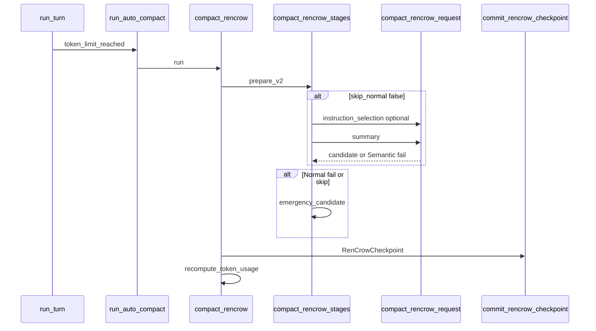

# 現状不具合 修正仕様・実装仕様

- 版: v0.1（2026-11-12）
- 対象: RenCrow Switch Core（`codex-rs/`）中心。監督・PORTAL は境界と受入のみ記載。
- 正本との関係:
  - 容量圧縮: [COMPACTION_SPEC.md](../COMPACTION_SPEC.md) 第1〜2部が優先。本書は未解決運用ギャップへの**修正契約**。
  - 自律完了: [AUTONOMOUS_COMPLETION_SPEC.md](../AUTONOMOUS_COMPLETION_SPEC.md) / [AUTONOMOUS_COMPLETION_IMPLEMENTATION.md](../AUTONOMOUS_COMPLETION_IMPLEMENTATION.md)。
  - 課題境界: [TASK_CONTEXT_COMPACTION_SPEC.md](../TASK_CONTEXT_COMPACTION_SPEC.md)（容量反復とは別）。

検証手順の誤り（再開と起動の混同、製品 review と内部修正の混同、異種 token 比較）は**完了条件に含めない**。

---

## 0. 修正一覧（優先と状態）

| ID | 不具合 | 優先 | 根因確度 | 修正 | 実装 |
|---|---|:---:|:---:|---|---|
| FIX-001 | 人間「続けて」で `paused` が解除されない | P0 | 確定 | 仕様確定 | 未実装 |
| FIX-002 | Compaction 長時間化・反復による停滞 | P1 | 因果整理済み・効果未確認 | Phase0観測＋Phase1は承認後 | 部分（計測・抑止のみ） |
| FIX-003 | レビュー子無応答・親 wait ループ | P1 | 運用観測・回収なし | 監督契約 | 進行中 |
| FIX-004 | PORTAL 最終 review 未完 | P2 | 製品境界 | review 完了手順 | 実装済み・review未 |
| FIX-005 | 画面脈動・ちらつき | P2 | 未確定 | tmux/描画 | 部分確認 |
| FIX-006 | 自律完了 C01-v6 総合 E2E | P1 | タイムアウト | マトリクス継続 | 未完了 |

**部分解決（追認のみ・追加修正は条件付き）**

| ID | 内容 | 追認境界 |
|---|---|---|
| ACK-001 | Compaction working tail | status/update + 直近単独 `cat`、組12KiB。任意 read 全保持は非保証 |
| ACK-002 | PORTAL browser 保存→再開 | handler 配線実測済み。製品 review が完了条件 |

---

## 1. 仕様体系（Compaction 実装の読み方）

### 1.1 上位（第1部）

- 目的: 古い指示の復活禁止・有効指示・未完了作業・原本保全（P0→P4）。
- Recovery Ladder: Normal V2 → Emergency →（本スコープ外）Level 3/4。
- Auto Retry（§42）: 同じ履歴・同じ条件の Normal **失敗**を自動で繰り返さない。

### 1.2 実装凍結（第2部 v0.7）

| 段 | 契約 | 実装の所在 |
|---|---|---|
| Prepare | snapshot・hash・rollout・projection | `compact_rencrow_stages::prepare_v2` |
| Select | 0〜1回 LLM（基本指示なし JSON 段） | `drain_instruction_selection` |
| Preflight | floor が上限超なら CapacityBlocked | `preflight_compaction_floor` |
| Summarize | 0〜1回 LLM（最大計2 request） | `request_compaction_summary` |
| Commit | CAS・履歴 owner | `commit_rencrow_checkpoint` |

**自動行為（§64）とコード**

| §64 | 挙動 | コード |
|---|---|---|
| Normal semantic/model failure | → Emergency | `StageFailure::Semantic` in `compact_v2` |
| Same history Normal 失敗 | Normal skip → Emergency | `normal_skipped` + `rencrow_normal_failed_hash` |
| Capacity | CapacityBlocked | `StageFailure::Capacity` |
| Integrity | IntegrityBlocked | `StageFailure::Integrity` |
| 同一履歴で自動全体失敗 | 自動再送抑止 | `auto_retry_suppressed`（F03） |

### 1.3 ランタイム発動（turn 統合・正本補足）

正本は「trigger を再実装しない」（§9）。発動は [`context_window_token_status`](../codex-rs/core/src/session/context_window.rs) と [`run_turn`](../codex-rs/core/src/session/turn.rs)。

| Phase | 条件（要約） | 呼び出し |
|---|---|---|
| PreTurn | `token_limit_reached` | `run_pre_sampling_compact` → `run_auto_compact` |
| MidTurn | `needs_follow_up && token_limit_reached` | 圧縮後 `continue`（同ターン再采样） |
| PostTurn | `model_post_turn_compact_threshold_percent > 0` かつ idle | 既定 0 なら通常オフ |

RenCrow 経路: `compaction_route` → `compact_rencrow::run` → `compact_v2`。

---

## FIX-001: 人間入力「続けて」で自律完了が再開しない

### 症状

- `rencrow_completion_paused == true`（契約 `paused` も true）のまま。
- 人間が「続けて」等を送っても受付はされるが、pause が解除されない。

### 根因（確定）

- 明示再開は **`start_if_idle` のみ**で `resume_autonomous_completion_from_user_turn` を呼ぶ（[`turn_input.rs`](../codex-rs/core/src/session/turn_input.rs) L451–615）。
- 通常 TUI / 既定 RPC は **`TurnInputMode::StartOrSteer` → `start_or_steer`**。アイドル時新規ターン開始（L385–434）は **resume 判定を通らない**。
- `is_explicit_human_autonomous_resume` は intake receipt と `InputAuthor::Human` を要求（「続けて」/ 英語固定句）。認識だけでは pause を変えない（[`turn_input_tests.rs`](../codex-rs/core/src/session/turn_input_tests.rs) L160–185）。

### 修正仕様（不変条件）

1. **単一の再開ゲート**: 「明示的人間による自律完了再開」の条件判定と `resume_autonomous_completion_from_user_turn` 呼出しは **StartIfIdle と StartOrSteer の新規ターン開始で同一**とする。
2. **既存ゲートを変更しない**:
   - 対象ソース: `SessionSource::Cli | VSCode | Exec` のみ。
   - `rencrow_autonomous_completion` が ON。
   - テキスト・client_id・intake receipt の照合は `is_explicit_human_autonomous_resume` のまま。
   - automation 起点の同名テキストは再開しない。
3. **失敗時**: resume 永続化失敗は `pause_autonomous_completion` に戻し、**ターン開始を取り消す**（`start_if_idle` と同じ）。
4. **steer 経路**: アクティブターンへの steer では本再開を行わない（既存 semantics）。

### 実装仕様

| 項目 | 内容 |
|---|---|
| 主ファイル | `codex-rs/core/src/session/turn_input.rs` |
| リファクタ | `explicit_completion_resume` 判定を関数化（例: `should_resume_autonomous_completion(session, kind, input) -> bool`）。`TurnStartKind::User` かつ `expected_previous_turn_id.is_none()` 等は現行 `start_if_idle` と同等。 |
| 挿入点 | `start_or_steer` の `NotSubmittedReason::NoActiveTurn` 分岐で、`apply_started` 成功後・`spawn_task` / `start_task` 前に、`start_if_idle` と同じ resume ブロックを実行。失敗時は turn 予約解除。 |
| 触らない | `resume_autonomous_completion_from_user_turn` の永続化契約、`is_explicit_human_autonomous_resume` の文言セット（別仕様で拡張するまで）。 |
| 検査 | **RED**: `TurnInputMode::StartOrSteer`、pause 中、有効 human intake + 「続けて」→ `autonomous_completion_paused()` が false。 **GREEN**: 上記実装。 **対照**: automation receipt、receipt なし、steer 時は pause 維持。既存 `StartIfIdle` テスト回帰。 |
| 検証記録 | `Tmp/ren2-supervision/periodic/human-resume-20261112/status-verification.json` を更新 |

### 受入条件

- [ ] 通常 TUI 経路（StartOrSteer）で「続けて」→ `paused=false`、snapshot 永続化成功。
- [ ] 再開後、自律継続ターンが `mark_autonomous_completion_turn` を通る（pause 中は拒否される現行契約を満たす）。
- [ ] 検査・監督で「人間入力受付」と「pause 解除」を別イベントとして混同しない。

---

## FIX-002: Compaction 長時間化・反復

### 症状

- 1回の圧縮が長い（選別＋要約の `drain_to_completed`）。
- 同一作業で圧縮が繰り返され、進行が止まったように見える。

### 根因（整理済み・仕様上の許容範囲）

| 要因 | 仕様/コード |
|---|---|
| 長さ | Normal 最大 2 LLM（§17）。MidTurn `TurnPrefix` は通常プロンプト規模を要約入力に載せる（提案A）。 |
| 反復 | MidTurn: 圧縮成功後も `needs_follow_up` かつ見積りが再び `token_limit_reached`。`check_context_budget` は「1 token でも縮小」で可。 |
| 既対策 | `auto_retry_suppressed`（失敗履歴）、保留入力（解決済み）、working tail（ACK-001）、段別 Warning 秒数。 |
| 限界 | Normal 不成立時 Emergency は reasoning/call 残存（Failure Knowledge）。Level 3/4 はスコープ外。 |

### 修正仕様（段階）

**Phase 0 — 観測契約（挙動変更なし・P0 意味を弱めない）**

1. 実 thread で次を 1 セッション分記録する（Tmp JSON）:
   - 各 compaction の `instruction_selection` / `summary` 秒数（既存 Warning）。
   - `RenCrow compaction applied` vs Emergency 文言。
   - 直前/直後の `active_context_tokens`、`auto_compact_scope_tokens`（**同種のみ**比較）。
   - 同一 `sub_id` 内の MidTurn 圧縮回数。
2. 「改善」と言えるのは Phase 0 ベースライン取得後、同一 thread・同種負荷での比較のみ。

**Phase 1 — 挙動変更（利用者承認後のみ。COMPACTION_SPEC §80 凍結に抵触しうる）**

候補（採用は 1 件ずつ、受入を分離）:

| 案 | 概要 | リスク |
|---|---|---|
| 1-A | MidTurn で `TurnPrefix` を使わず常に縮小済み `summary_history` のみ | prefix cache 利益低下 |
| 1-B | 圧縮後見積りにヒステリシス（上限 − margin まで再発動しない） | フル窓超過タイミング変化・要設定 |
| 1-C | PostTurn 閾値の明示設定でターン末に前倒し圧縮 | 設定依存 |

**Phase 1 は Phase 0 未了では着手しない。**

### 実装仕様（Phase 0）

| 項目 | 内容 |
|---|---|
| 既存 | `drain_compaction_prompt` の Warning、`CompactionAnalyticsAttempt`（あれば thread テレメトリ） |
| 追加（任意） | analytics fact に `stage`, `phase`, `duration_s`, `history_hash` を載せる小変更（core のみ） |
| 検査 | 結合テストは既存 compaction suite。実測は手順書のみ本書に保持 |

### 受入条件（Phase 0）

- [ ] 停滞再現 thread で B4 観測表（プラン参照）が埋まる。
- [ ] Normal/Emergency 比率と MidTurn 連続回数が数値で残る。

---

## FIX-003: レビュー子無応答・親 wait ループ

### 症状

- レビュー子が長時間応答せず結果未回収。
- 親が wait・再送・状態調査を繰り返す。

### 修正仕様（監督層・Switch Core 外中心）

1. **回収 SLA**: 子 turn に `deadline` / `cancellation` を必ず付与。timeout 時は terminal 状態を host が確定し、親は **同一子への無条件再送を禁止**（回数ではなく「子 generation / call_id」で idempotency）。
2. **親ループ**: 「結果未取得」のとき次アクションは {再依頼 1 回, 人間 escalation, paused} のいずれかを ledger に記録。同一エラー文での連続 wait を禁止。
3. **証拠**: 子の `RawResponseCompleted` または明示失敗イベントが無い限り、レビュー採用・失敗解決扱いをしない（自律完了の既存契約と一致）。

### 実装仕様（境界）

| 層 | 担当 |
|---|---|
| Core | 子 session の turn 終端・中断は既存。変更は FIX-001 等と競合しない範囲のみ。 |
| 監督 CLI | timeout、子状態ポーリング上限、ledger 更新（RenCrow 監督 skill 手順に従う）。 |
| 受入 | 子を意図的に無応答にした scenario で、親が N 分後に escalation し無限 wait しないログ |

**現状**: 子結果未取得のため FIX-003 は**未完了**。Core 単体では閉じない。

---

## FIX-004: PORTAL 最終 review

### 修正仕様

- 内部 AC1〜4 達成と **製品 review 単位の完了**を分離（混同禁止）。
- 完了条件: browser 縦断 JSON + review 採用記録 + 回帰検査 green。

### 実装仕様

- 成果コード: StoryPlayer owner 配線（実測済み経路）。残作業は review ワークフローのみ。
- 根拠: `Tmp/new-thread-20261111/ac3-browser-vertical.json`

---

## FIX-005: 画面脈動

### 修正仕様

- tmux クライアントサイズ・`aggressive-resize` 等の設定を固定し、pane 内描画が安定していることを実画面で確認するまで「解決」としない。

### 実装仕様

- 設定変更は運用 repo / dotfiles 側。Switch Core コード変更は不要とみなす（真因が描画バグと判明した場合のみ別 ID）。

---

## FIX-006: C01-v6 総合 E2E

### 修正仕様

- [AUTONOMOUS_COMPLETION_SPEC.md](../AUTONOMOUS_COMPLETION_SPEC.md) の適用表（圧縮2回・cold resume 等）に沿い、ケースごとに **対応 compaction 経路を固定**してから再実行。
- タイムアウトは「未完了」。部分成功（candidate13 等）は総合合格の代用にしない。

### 実装仕様

- FIX-001 完了後に resume 系ケースを再実行。FIX-002 Phase 0 は圧縮ケースの計測に併用。

---

## 付録 A: モジュール責務（Compaction 実装マップ）

| モジュール | 責務 |
|---|---|
| `session/context_window.rs` | 発動用量・上限フラグ |
| `session/turn.rs` | Pre/Mid/Post 自動圧縮呼出し |
| `compact.rs` | route・`drain_to_completed`・inline task |
| `compact_rencrow.rs` | `run` / `compact_v2`・失敗 fingerprint |
| `compact_rencrow_stages.rs` | prepare・normal・emergency |
| `compact_rencrow_request.rs` | LLM 段・`SUMMARY_INSTRUCTION` |
| `compact_rencrow_native.rs` | 置換履歴再構築 |
| `compact_rencrow_candidate.rs` | 候補検証・`check_context_budget` |
| `session/rencrow_compaction.rs` | checkpoint commit・hash 旗 |

## 付録 B: データフロー（1回の自動圧縮）

---

## 変更履歴

| 日付 | 内容 |
|---|---|
| 2026-11-12 | 初版。FIX-001 根因を turn_input 二経路に特定。Compaction は Phase0/1 分離。 |
| 2026-11-12 | `docs/` 配下へ配置。リンクをリポジトリ相対パスに修正。 |
