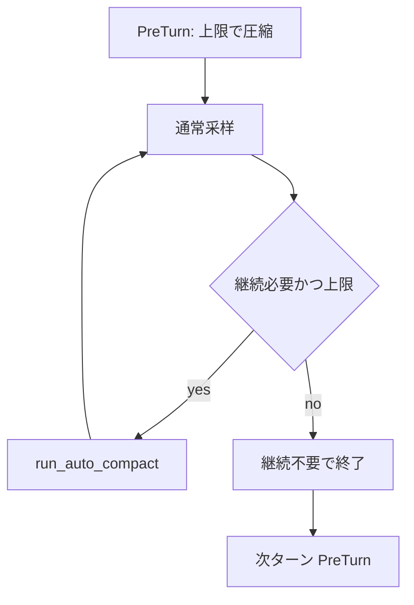

# Codex-switch・Compaction・監督・PORTAL 整理

**修正仕様・実装仕様の正本（本依頼）**: [CURRENT_FIX_IMPLEMENTATION_SPEC.md](./CURRENT_FIX_IMPLEMENTATION_SPEC.md)（FIX-001〜006、Compaction §1 整理、付録マップ）。

本文は (A) 作業全体の達成状況、(B) Compaction「長い・繰り返す」の技術的因果、(C) 証拠パスと検証上の注意、の順。実装着手順は上記 FIX 一覧の優先に従う。

検査手順上の誤り（起動確認と再開確認の取り違え、製品 review 未完と Switch 内部修正完了の混同、種類の違う token 値の比較）は**製品不具合の解決実績に数えない**。以下の「解決したもの」はユーザーが根拠付きで確定したもののみ。

---

## A. 解決したもの（同種を統合）

| テーマ | 要点 | 根拠（Tmp） |
|---|---|---|
| 検査履歴と受理の一貫性 | 後の成功で過去の失敗が消えない。受理と最終実行ガードが同じ状態を参照 | `autonomous-completion-20261111/consistency-repair/status.json` |
| 複合コマンドの最終拒否 | 検査入口と最終判定で分類を共用。不適合は実行・証拠発行前に拒否 | 上記 status |
| 成果物変更後の条件未達復帰 | 再開時ハッシュ照合で達成済みを戻し、旧証拠を保持して新検査へ | 上記 + `candidate13-e2e-adoption.json` |
| paused と正常終了 | 正常終了と中断を区別。正常終了後 paused=false、無操作120秒待機 | `candidate13-e2e-adoption.json` |
| 課題閉鎖後の active scope | scope 閉鎖と checkpoint 保存順を修正。再開後 active_scope=null | consistency-repair 系 |
| checkpoint 監督確認 | 履歴 owner 検証の読取専用 CLI | consistency-repair 系 |
| Rust/Python 証拠ハッシュ | Python シリアライズを Rust 契約に合わせた | consistency-repair 系 |
| accept と実行単位 | task ID / revision / review と実行単位を厳密解決し host 証拠を正規化 | `candidate-17/deployment.stdout.log` |
| Compaction 中の追加入力 | 保留入力を保持し後続へ渡す（core・TUI・子待機） | 関連検査成功（上記一連） |
| 公式 Codex 指示の混入分離 | 共通 AGENTS から公式専用を分離。新スレッドで初期入力に混入なし | 運用確認記録 |
| 监督の永久停止 | 全体回数だけで止めない。個別上限と停止ガードは維持 | `ren2-supervision/supervisor-repair-20261112/verification.json` |
| 定型監査の LLM 排除 | 通常監査を CLI 化。連続監査で追加 LLM なし | 上記 verification |
| 別証拠での失敗解決扱い防止 | task/revision/ファイル/受理/review の一致必須 | consistency-repair 系 |
| thread 対応と cooldown | 永続化と実試行時刻ベースの有限 cooldown | supervision 系 |

**Compaction 関連でここに入るもの**: 圧縮・子待機中の追加入力（解決）。同じ失敗履歴への自動再試行抑止（[`auto_retry_suppressed`](../codex-rs/core/src/compact_rencrow.rs) として実装済み・整備済みだが、**長時間化・反復による停滞の改善は未確認** → 下記「未解決」）。

---

## A'. 限定範囲で直ったもの・最終確認が残るもの

| テーマ | 直したこと | 残る境界 | 証拠（Tmpはprivateでrepo配布外） |
|---|---|---|---|
| Compaction 後の直近データ消失 | 最新 task status/update と直近の単独 `cat`（各組 12KiB 以内）を保持 | 任意の読取結果すべての保持は非保証。実装は [`protected_working_tail_call_ids`](../codex-rs/core/src/compact_rencrow_stages.rs) | `candidate-15/working-tail-source-review.json` |
| 音声 fixture | 実音声・デコーダ・ハッシュ・定数照合。AC1 受理・review 採用まで | — | `voice-decode-proof/result.json` |
| PORTAL browser 保存 | 製品 handler → StoryPlayer owner。ブラウザで選択→保存→再開実測 | 2026-11-12時点: **最終 review 未完了**。今回未再検証 | `new-thread-20261111/ac3-browser-vertical.json` |
| 画面脈動・ちらつき | tmux 寸法・追従調整。pane 内安定は確認 | 2026-11-12時点: 実画面の解消・真因確定は未完了。今回未再検証 | `switch-redraw-20261111/verification.json` |

---

## A''. 解決していないもの

| テーマ | 試したこと | 状態 | 証拠（Tmpはprivateでrepo配布外） |
|---|---|---|---|
| FIX-001「続けて」で paused 解除 | 共通resume判定を両開始経路に接続、focused test green | human intakeとpause解除を確認。`autonomous_mark_verified=false` のため自律mark受入は未確認 | `Tmp/ren2-supervision/periodic/human-resume-20261112/fix001-green-focused.log`; `Tmp/ren2-supervision/periodic/human-resume-20261112/status-verification.json` |
| FIX-003 reviewer deadline / parent wait | reviewer deadline enforcement、generation-bound abort、durable terminal/escalation実装。scoped 17 testsとscripted loopback faults 3件pass。通常Qwen parent/child KAT実測あり | 元のreviewer無応答E2Eと実LLM hang注入は未実施。別件full-fork delegation diagnostic不合格はFIX-003受入に含めない。reviewer期限は通常10分、通常child期限は既定未設定（[`CHILD_MONITOR.md`](../CHILD_MONITOR.md)）。本番ren2既存プロセスは最新pairへ未再起動（Gateway/Runtimeは再起動済み）、user pause維持 | `Tmp/ren2-supervision/periodic/private/child-monitor-implementation-20261113/full-check/merged-test-outcomes.json`; `Tmp/ren2-supervision/periodic/private/simple-llm-live-20261114/acceptance.json`; `Tmp/ren2-supervision/periodic/private/residuals-1-4-20261114/core/feature-proof.json`; `Tmp/ren2-supervision/periodic/private/residuals-1-4-20261114/core/install.json` |
| **Compaction 長時間化・反復による停滞** | Phase 0 baseline取得、1-A凍結fixture比較実施 | Phase 0完了。1-Aは優位性なしで非採用。実運用の停滞改善未確認。1-B/1-Cは未評価候補 | — |
| PORTAL 最終 review | AC1〜4 は達成表示 | 2026-11-12時点: review単位running。今回未再検証 | — |
| 自律完了 C01-v6 総合 E2E | 最小再開・変更検知は成功 | 2026-11-12時点: 総合timeout、全経路合格未確認。今回未再検証 | — |

---

## B. Compaction「長い・繰り返す」技術因果（コード読み取り）

未解決項目「Compaction 長時間化・反復」と、既に整備済みの機構（保留入力、working tail、auto retry 抑止）を分けて読む。

### B1. 発動条件

[`context_window_token_status`](../codex-rs/core/src/session/context_window.rs):

- `token_limit_reached`: スコープ使用量 ≥ `model_auto_compact_token_limit` + fallback buffer、または `active_context_tokens` ≥ フル窓（`effective_context_window_percent`、既定 95%）。
- `turn_end_compaction_threshold_reached`: `model_post_turn_compact_threshold_percent > 0` のときのみ（既定 0 → PostTurn 自動圧縮は通常オフ）。

[`run_turn`](../codex-rs/core/src/session/turn.rs):

1. **PreTurn**（`run_pre_sampling_compact`）: 既に上限なら新ユーザー入力前に圧縮。
2. **MidTurn**（采样後 `should_roll_over`）: `needs_follow_up && token_limit_reached` → 圧縮 → `continue` で同ターン采样再開。コメントは「圧縮で大幅に下がる前提」でループ許容。
3. **PostTurn**: パーセント閾値が有効かつ pending 入力なしのときのみ。

経路: [`compaction_route`](../codex-rs/core/src/compact.rs) → RenCrow 時 [`compact_rencrow::run`](../codex-rs/core/src/compact_rencrow.rs)。

### B2. 1回が長い理由

[`compact_v2`](../codex-rs/core/src/compact_rencrow.rs) → Normal 最大 **2 回**のモデル完了待ち（[`normal_candidate`](../codex-rs/core/src/compact_rencrow_stages.rs)）:

- `instruction_selection`: [`drain_instruction_selection`](../codex-rs/core/src/compact_rencrow_request.rs)（実行役 basic 指示なし）。
- `summary`: [`request_compaction_summary`](../codex-rs/core/src/compact_rencrow_request.rs)。MidTurn かつ削除なし時は **直前通常プロンプト全体 + 要約指示**（`TurnPrefix`）→ 入力規模が上限付近のまま待つ。

いずれも [`drain_compaction_prompt`](../codex-rs/core/src/compact_rencrow_request.rs) → [`drain_to_completed`](../codex-rs/core/src/compact.rs) までストリーム待ち。Warning: `RenCrow compaction {stage}: {秒}s`.

- Normal 意味失敗 → Emergency（モデルなし）だが **要約待ち時間は既に消費**。
- 同一 `history_hash` で Normal 失敗済み → 自動は [`normal_skipped`](../codex-rs/core/src/compact_rencrow.rs) で Emergency 直行。履歴が変わると再び Normal から（要約待ちが戻る）。
- 同一履歴で自動圧縮全体が失敗記録 → [`auto_retry_suppressed`](../codex-rs/core/src/compact_rencrow.rs)（再送ループはここでは止まる）。

**整備済みだが停滞未確認**: 段階計測 Warning、保留入力（解決済み）、working tail（部分解決）。

### B3. 圧縮後 token 再計算と「すぐまた発動」

成功時 [`recompute_token_usage`](../codex-rs/core/src/session/mod.rs): `TokenUsageSource::CurrentHistoryEstimate`。発動判定は圧縮要求の usage ではなく **置換後履歴見積り**。

[`check_context_budget`](../codex-rs/core/src/compact_rencrow_candidate.rs): `after < before`（1 token でも可）、フル窓未満。**上限のすぐ下まで残す設計**は意図的。ターン終了パーセントまで下げる条件はない。

- `BodyAfterPrefix`: prefill 再設定でスコープ使用量いったん 0 → 次の sampling/tool で再び上限へ速い。
- Normal 不成立が続くと reasoning/call が残り膨張（[`COMPACTION_SPEC.md`](../COMPACTION_SPEC.md) Failure Knowledge「Emergency 縮小不足」）。

### B4. 実測で閉じる観測（baseline取得済み・停滞改善は未確認）

| 観測 | 意味 |
|---|---|
| `instruction_selection` / `summary` 秒数 | 1回の長さ |
| `RenCrow compaction applied` vs `Normal semantic compaction was unavailable` | Normal 成立 vs Emergency |
| 同一ターンで `applied` が采样間に複数 | 再計算後も上限直下 → MidTurn ループ |
| 圧縮直後の `active_context_tokens` と次采样までの増分 | 反復間隔 |

2026-11-14時点でPhase 0 baselineは20行（16 capacity / 4 task boundary）、Normal 16 / Emergency 0（16:0）。同一turn MidTurn回数は4/8/2/2、段別時間を記録済み。1-A同一凍結fixtureはinput +160 (+3.03%)、total +826、時間は約12.8秒増で意味情報を保持したが、優位性が示されず非採用。定量値は意味品質ACを証明せず、単一fixtureを本番性能改善とみなさない。1-B/1-Cは未評価候補。証拠: `Tmp/ren2-supervision/periodic/human-resume-20261112/fix002-phase0-baseline-v2.json`, `Tmp/ren2-supervision/periodic/human-resume-20261112/fix002-1a-live-rencrow-provider-v1/result-analysis-v2.json`。

課題境界の履歴整理は [`TASK_CONTEXT_COMPACTION_SPEC.md`](../TASK_CONTEXT_COMPACTION_SPEC.md)（容量反復とは別）。

---

## C. 因果の対応表（ユーザー整理 ↔ コード）

| ユーザー上の位置づけ | コード・仕様上の位置づけ |
|---|---|
| 圧縮中追加入力（解決） | `input_queue` / mid-turn との直交。発動ループとは別軸 |
| working tail（部分解決） | `protected_working_tail_call_ids` + task boundary 保護。info 消失の一部のみ |
| 失敗履歴の自動再試行抑止（整備済み・効果未確認） | `auto_retry_suppressed` / `records_auto_failure` |
| **長時間・反復停滞（未解決）** | B1 MidTurn ループ + B2 最大2× `drain_to_completed` + B3 見積りが上限直下 |

---

## D. 推奨する次の作業順（実行は別承認）

1. **FIX-001受入**（todo `human-resume-paused`）: 自律mark条件を確認。pause解除のfocused検証は済み。
2. **Compaction改善の必要性を判断**: Phase 0は完了、1-A比較済み・非採用。1-B/1-Cは未評価候補であり、実測や実装を自動着手しない。
3. **FIX-003 reviewer無応答E2E**: 元のACを検証し、子結果回収まで完了判定を保留。
4. **PORTAL**（todo `portal-final-review`）: 内部 AC と製品 review 完了を分離して締める。

---

# 実行結果報告（整理フェーズ）

## 概要

Codex-switch・Compaction・監督・PORTAL を解決 / 部分 / 未解決に統合し、未解決の Compaction 停滞を「発動 → モデル待ち → 再計算」の既存解析に接続した。検査手順の誤りは解決実績から除外した。

## 実行ステップ

1. ユーザー提示の表をテーマ統合し、根拠 Tmp パスを付与。
2. Compaction 関連を「追加入力解決」「working tail 部分」「反復停滞未確認」に分離。
3. 既存プラン本文（B1–B4）を維持し、対応表と次作業順を追加。

## 最終成果物

- リポジトリ: `docs/compaction_length_repeat_0df44455.plan.md`（本ファイル）
- Cursor プラン: `~/.cursor/plans/compaction_length_repeat_0df44455.plan.md`

## 課題対応

- **未解決のまま明示**: Compaction 全体所要・頻度、paused「続けて」、レビュー子、C01-v6、PORTAL 最終 review、画面ちらつき実画面。

2026-11-14追記（上記「整理フェーズ」報告は2026-11-12時点の履歴）: FIX-001 pause解除focused検証済みだが自律mark受入は未確認。FIX-002 Phase 0完了、実運用の性能改善未確認。FIX-003実装と限定検証済みだが、reviewer無応答E2E/実LLM hang注入は未実施。PORTAL・画面脈動・C01-v6は2026-11-12時点の状態を保持し、今回未再検証。

## 注意点

- token 表示値の種類（サーバ usage / 見積り / スコープ）を混ぜないこと（過去の検証誤りと同種）。
- Switch 内部修正完了と製品 review 完了を同一の「完了」として報告しない。
